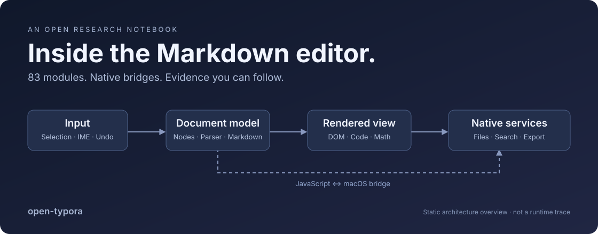

<p align="center">
  
</p>

# open-typora

**What happens between a keystroke and a saved `.md` file?**

An open research notebook on Typora's editor: the document model, live rendering, undo, source mode, and the JavaScript ↔ macOS boundary. Follow the implementation through module identities, byte offsets, native methods, and explicitly stated unknowns.

[](https://github.com/yruichen/open-typora/actions/workflows/check.yml)
[](LICENSE)
[](docs/methodology.md)

**[Read the interactive report →](https://yruichen.github.io/open-typora/)** · [中文 README](README.zh-CN.md) · [Evidence indices](data/) · [Reproduce locally](docs/reproduce.md)

## Five findings worth opening the report for

1. **The visual editor keeps a document tree.** Nodes connect Markdown serialization, editable DOM, selection, and undo. Rendering is one part of a larger editing system.
2. **This Mac sample uses a native Cocoa shell and WebKit.** Shared JavaScript contains Node/Electron branches; those branches do not establish how the Mac app runs.
3. **“Search” is two different systems.** Quick Open uses `NSMetadataQuery`; folder-content search selects a bundled `rg` executable and handles its process output.
4. **Export crosses the bridge in both directions.** `export.exportToNative` is a JavaScript handler called by native code. Pandoc, HTML, PDF, and printing have distinct paths.
5. **Source mode changes the editing machinery.** Markdown comes from CodeMirror in source mode and from the node model in visual mode, with separate undo paths.

Each finding links back to a [report section](docs/report.zh-CN.md) and a machine-readable index. Same-name endpoints are static correspondence, not proof of runtime execution.

## The map, in numbers

| Indexed scope | Count |
| --- | ---: |
| Main editor System modules | **83** |
| Native defined Objective-C classes | **98** |
| Native method implementation records | **2,017** |
| JavaScript literal bridge callsites | **193** |
| JS callsites with matching opposite-direction native endpoints | **182** |
| Packaged regular files in the manifest | **693** |

Counts describe the analyzed sample. “2,017 methods” is an implementation inventory, not 2,017 independently understood features.

## Start with the question you care about

| Your question | Read this |
| --- | --- |
| How does live Markdown editing work? | [Editor findings](data/editor-findings.json): parser, node model, Brush, selection, undo |
| Where is a feature in the bundle? | [83-module map](data/modules.json), with dependencies and offsets |
| Which side of the bridge owns an operation? | [Bridge endpoint pairs](data/bridges.json) |
| How do search, saving, and export reach macOS? | [Native findings](data/native-findings.json) and [method registry](data/native-methods.json) |
| What does this sample actually contain? | [File manifest](data/package-manifest.json) and [sample identity](data/sample.json) |
| How can I verify or improve a claim? | [Methodology](docs/methodology.md) and [reproduction guide](docs/reproduce.md) |

The detailed report is currently in Chinese. Module names, interfaces, indices, and most evidence annotations are readable in English. English report contributions are welcome.

## Read it locally

No Typora installation is needed to read the published report.

```bash
git clone https://github.com/yruichen/open-typora.git
cd open-typora
python3 -m http.server 8765 --bind 127.0.0.1
```

Open **http://127.0.0.1:8765/docs/**. The report is static; its table filter runs locally and has no analytics.

To rebuild and validate the report:

```bash
npm ci
npm run build
npm run check
```

Use Node.js 24.11 or newer. Analyzing a target is a separate, opt-in procedure documented in [Reproduce](docs/reproduce.md).

## Repository layout

```text
open-typora/
├── docs/                  # Interactive report, Markdown, methodology
│   └── assets/            # Original architecture visual and report UI
├── data/                  # Sanitized findings and factual indices
├── tools/                 # Read-only analyzers, renderer, validation
├── .github/               # CI and evidence-first issue template
└── .local/                # Ignored local inputs and generated evidence
```

## What this project establishes

The current dataset comes from **Typora 1.9.4, build 7260, on macOS**, with native body inspection focused on **arm64**. The sample failed code-signature verification. Its correspondence to an official release has not been established; conclusions are tied to the recorded hashes.

The main bundle's 83 registrations are indexed. Native analysis combines metadata, assembly, and literal argument recovery. Deep Hopper decompilation was blocked by bridge startup, and behavioral equivalence has not been tested. Those gaps stay visible in the report.

This is an independent architecture study. The repository contains original research prose, original tooling, and derived factual indices. It does not distribute Typora, its complete bundled source, complete disassembly, activation material, or private documents. [Publication boundaries](NOTICE.md) explain the scope of the license.

## Help make the map better

Useful contributions include:

- Corroborating a claim against a known official release and recording its hash.
- Adding a controlled test for a specific parser, undo, or source-mode behavior.
- Resolving an unmatched bridge endpoint with a precise location.
- Comparing a newer version without treating minified names as persistent identity.
- Translating the report or improving its explanation of an existing evidence chain.

See [CONTRIBUTING.md](CONTRIBUTING.md). A good contribution makes a claim easier to verify; an unsupported claim makes the map harder to use.

## Acknowledgements

This investigation was supported by **[REA — Reverse Engineer Anything](https://github.com/morluto/rea)**, which provided local artifact analysis, Mach-O inspection, and structured evidence workflows. Thank you to its contributors for making agent-assisted reverse engineering easier to inspect and reproduce.
