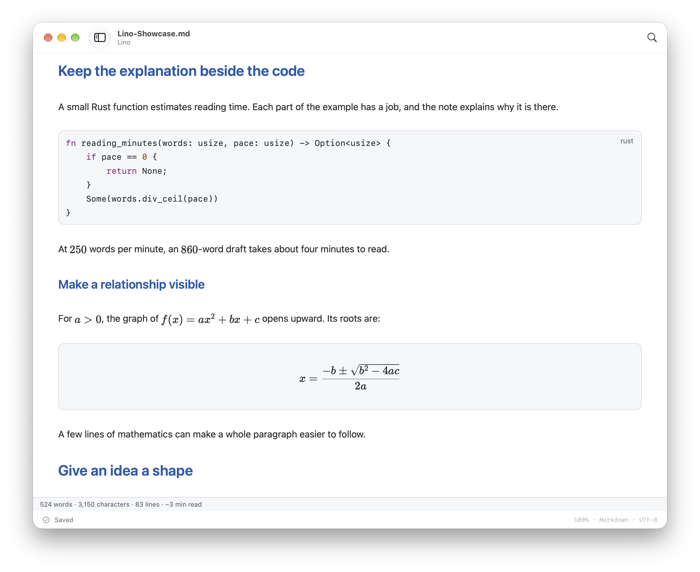

<div align="center">


# Lino

**为 macOS 打造的开源 Markdown 编辑器。**

直观的 Markdown 编辑，原生 Mac 窗口与标签页，保存在自己手中的文件。

[](https://github.com/yruichen/lino/releases/tag/v0.1.2)
[](https://github.com/yruichen/lino/releases/tag/v0.1.2)
[](LICENSE)

[**下载**](https://github.com/yruichen/lino/releases/download/v0.1.2/Lino-v0.1.2-macos-arm64.zip) · [Homebrew](#homebrew) · [功能](#功能) · [构建](#从源码构建) · [反馈问题](https://github.com/yruichen/lino/issues) · [English](README.md)

</div>


Lino 将 Markdown 视觉编辑与原生 Mac 工作区结合在一起。在同一个编辑器里撰写笔记、项目文档和技术文章，编辑代码、表格、公式与图表。通过侧栏浏览文件夹、按大纲定位章节，用原生标签页切换文档。

## 功能

- **视觉与源码编辑** — 编辑时直接查看 Markdown 排版。按 **⌘/** 切换源码，两种模式共用撤销历史。
- **代码、公式与图表** — 代码语法高亮、可编辑表格、KaTeX 公式、Mermaid 图表与图片预览。
- **文件导航与搜索** — 原生文件树与大纲侧栏、**⌘P** 快速打开、文件夹内容搜索，以及支持正则表达式的查找替换。
- **写作工具** — 专注模式、打字机模式、全文与选区字数统计，可调字体、行距和阅读宽度。
- **浅色与深色主题** — 六组配对主题、自定义主题导入与背景图片设置。
- **本地 Markdown 文件** — 直接打开和保存 `.md` 文件，支持可选自动保存、本地恢复副本与外部修改检测。
- **导出与打印** — 独立 HTML、PDF 导出与 macOS 打印。

界面支持**英语和简体中文**。




## 下载

需要 **Apple Silicon 芯片与 macOS 14 或更新版本**。

### Homebrew

```bash
brew install --cask yruichen/tap/lino
```

首次欢迎页只提供新建和打开文件，可从 **Lino → 欢迎使用 Lino…** 重开。下载副本还提供「安装并打开 Lino」，无需手动移动。Markdown 默认打开方式位于 **设置 → 通用**。安装不会自动接管现有文件关联；也可在 Finder 中选中 `.md` 文件，通过 **显示简介 → 打开方式 → Lino → 全部更改** 设置。

用 **⌘O** 打开文件，**⇧⌘O** 打开文件夹。访问受保护的位置时，macOS 可能请求权限；如果曾拒绝，可检查 **系统设置 → 隐私与安全性 → 文件与文件夹**，再重新打开。无需账号、辅助功能或完全磁盘访问权限。

### 直接下载

**[下载 Lino v0.1.2 macOS 版 →](https://github.com/yruichen/lino/releases/download/v0.1.2/Lino-v0.1.2-macos-arm64.zip)**

解压后，将 **Lino.app** 移到**应用程序**目录。发行说明与校验值见[发布页](https://github.com/yruichen/lino/releases/tag/v0.1.2)。

当前 macOS 构建采用临时签名，**尚未经过 Apple 公证**。如果系统阻止首次启动，可在**系统设置 → 隐私与安全性 → 仍要打开**中确认此应用。

Lino 正在持续开发，Markdown 兼容、无障碍和打印排版仍需测试。目前尚未提供 Windows 和 Linux 版本。

## 开始使用

按 **⌘O** 打开 Markdown 文件，或按 **⌘N** 新建文档。[展示样稿](examples/showcase/Lino-Showcase.md)包含正文、图片、代码、表格、公式与图表；打开时请保留旁边的图片目录。

| 操作 | 快捷键 |
| --- | --- |
| 快速打开 | ⌘P |
| 保存 / 另存为 | ⌘S / ⇧⌘S |
| 查找 / 下一个匹配 | ⌘F / ⌘G |
| 切换视觉 / 源码模式 | ⌘/ |
| 设置 | ⌘, |

界面语言位于 **Lino → 设置… → 通用 → 语言**。

<details>
<summary>文件与恢复支持范围</summary>

当前支持不超过 64 MiB 的普通 UTF-8 文件，保留 BOM 和混合换行。恢复副本以未保存文档打开，无法恢复尚未持久化的输入。Lino 原名 Open Typora，已有恢复数据保留原来的存放位置。

</details>

## 从源码构建

需要运行 macOS 14 或更新版本的 Apple Silicon Mac、包含 Swift 6 的 Xcode、Rust/Cargo，以及 Node.js 24.11 或更新版本和 npm。

```bash
git clone https://github.com/yruichen/lino.git
cd lino
npm ci
npm run app:build
open .local/build/Lino.app
```

Lino 使用 AppKit 构建原生界面，系统 WebKit 承载编辑器，Rust 提供共享文档服务。构建后的应用无需 Node.js 或开发服务器。重新构建前请退出 Lino。

## 参与贡献

欢迎提交 Bug、功能建议和 Pull Request。[反馈问题](https://github.com/yruichen/lino/issues)时，请附上 macOS 版本、复现步骤，以及相关的最小示例文档。

## 许可

采用 [MIT](LICENSE) 许可。Lino 独立于 Typora 及其开发者，署名与许可范围见 [NOTICE.md](NOTICE.md)。

感谢 [REA — Reverse Engineer Anything](https://github.com/morluto/rea) 提供应用分析工具与工作流。
