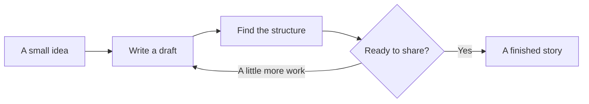

# A quiet place for your words

> Good tools bring you closer to what you want to say.

Morning light falls across your desk. You open a blank document and write down the first thought of the day. A sentence becomes a paragraph. A paragraph becomes something worth keeping.

**Lino is a home for that process:** notes, stories, code, and ideas, all in a Markdown file you can call your own.


## Begin with a small question

Writing does not always begin with an answer. Sometimes it begins with a question: What did I learn today? Why is this design confusing? How could I explain it more clearly next time?

**Record the facts**, *keep the questions*, and give your thoughts a little room to grow. Cross out an ~~old conclusion~~ when it no longer fits. Use `inline code` when a name needs to be exact.

Between one paragraph and the next, leave enough space to think.

### From an idea to a draft

- [x] Write the sentence that matters most.
- [x] Keep a useful example close to it.
- [ ] Add the details that help someone understand.
- [ ] Read it once more, then share it.

> A good note does not need to be finished in one sitting.
>
> Leave the question on the page. Give the answer a little time.

## Put your choices side by side

| A place to start | What belongs here | What matters |
| :--- | :--- | :--- |
| Everyday writing | A journal, a story, a reading note | A clear thought |
| Technical notes | A code example and its explanation | Useful detail |
| Project planning | A few tasks and the next decision | A workable next step |

## Keep the explanation beside the code

A small Rust function estimates reading time. Each part of the example has a job, and the note explains why it is there.

```rust
fn reading_minutes(words: usize, pace: usize) -> Option<usize> {
    if pace == 0 {
        return None;
    }
    Some(words.div_ceil(pace))
}
```

At $250$ words per minute, an $860$-word draft takes about four minutes to read.

### Make a relationship visible

For $a > 0$, the graph of $f(x) = ax^2 + bx + c$ opens upward. Its roots are:

$$
x = \frac{-b \pm \sqrt{b^2 - 4ac}}{2a}
$$

A few lines of mathematics can make a whole paragraph easier to follow.

## Give an idea a shape



The path is rarely straight. Keep the useful parts, change what needs changing, and return to the page.

## A few words worth keeping

An editor is part of a writing day. We move between paragraphs, add an explanation, remove a repetition, and come back to the first sentence to hear how it sounds. Small actions should feel connected, so we can stay with the thought we are trying to express.

Not everything needs to be finished today. Make one question clear. Keep one example. Give one image a better caption.

**Next time you open the document, your thought will be waiting.**
